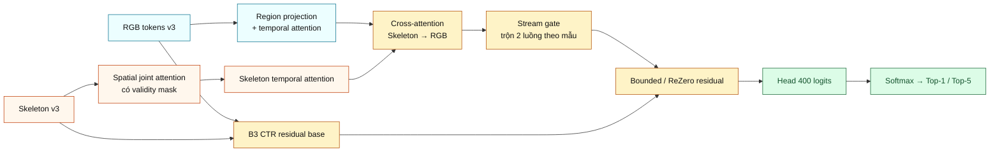
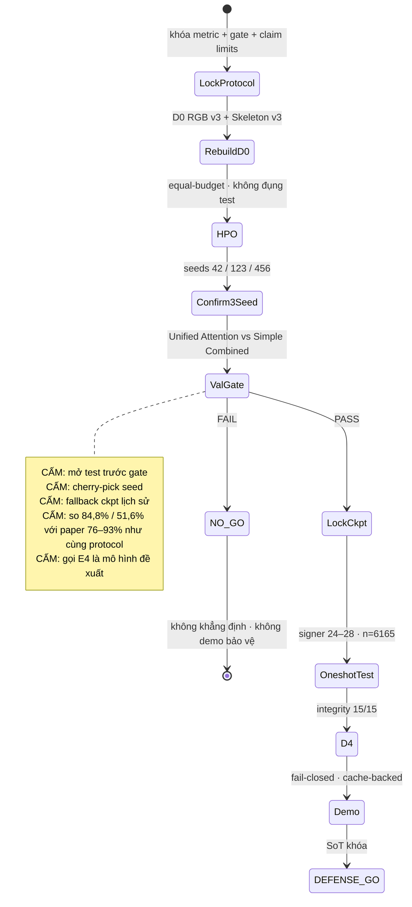
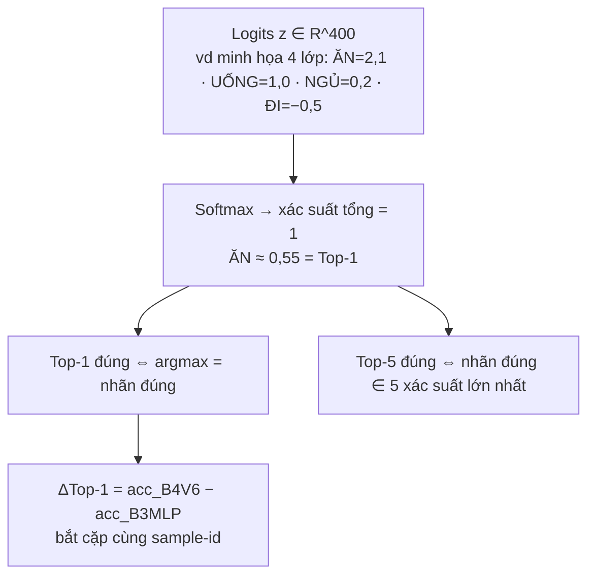

# Sơ đồ Mermaid chuẩn bảo vệ — MS-STA v6 / Unified Attention trên VSL400

> **SoT khóa (Aug 2026):** mô hình đề xuất **Unified Attention** · chiến dịch **`DEFENSE_GO`**.  
> Đối chứng mạnh: **Simple Combined** (encoder-matched).  
> Số liệu: [`B4_CURRENT_REPORT.md`](B4_CURRENT_REPORT.md) · [`phases/05_Evaluation.md`](phases/05_Evaluation.md).  
> Pipeline ngắn: [`MSSTA_END_TO_END_PIPELINE.md`](MSSTA_END_TO_END_PIPELINE.md).

**Cách dùng trước hội đồng:** mở file này trên GitHub / VS Code / Mermaid Live → phóng to sơ đồ chính (Hình M1). Đọc bảng chú thích ngay dưới sơ đồ trước khi trả lời.

---

## 0. Đọc nhanh (30 giây)

| Khối | Input | Việc làm | Output |
|---|---|---|---|
| A · Dữ liệu | Video Front VSL400 | Lọc eligible, tách signer | 24.752 mẫu · 400 gloss |
| B · D0 Feature | Cùng 1 clip | Trích RGB-token v3 + Skeleton v3 | 2 cache NPZ dùng chung |
| C · Học / so sánh | Cùng cache | Train RGB / B3 / Simple Combined / **Unified Attention** | Checkpoint theo seed |
| D · Validation | 3 seed 42/123/456 | Gate Δ, CI95, thắng mọi seed | **PASS** → khóa seed 42 |
| E · Test | Signer 24–28, n=6165 | Oneshot hồi cứu (không pristine blind) | Top-1/5, McNemar, CI |
| F · Demo | Cache + ckpt niêm phong | D4 15/15, fail-closed | Top-1/Top-5 + xác nhận người |

**Bằng chứng khóa:** Val Unified Attention **84,81 ± 0,51%** (Δ **+4,27 pp** vs Simple Combined; CI95 **[+2,94; +5,69]**). Test **51,55%** Top-1 (Δ **+9,33 pp**; CI95 **[+6,37; +11,34]**; McNemar 1047 vs 472).

---

## Hình M1 — Full-flow khoa học (Input → từng bước → Output)

Sơ đồ duy nhất đủ chi tiết để người mới lần theo mũi tên và hội đồng lần theo protocol.

```mermaid
flowchart TB
  %% ===== STYLE =====
  classDef input fill:#EAF2F8,stroke:#17365D,stroke-width:2px,color:#111
  classDef proc fill:#FFFFFF,stroke:#334155,stroke-width:1.5px,color:#111
  classDef rgb fill:#ECFEFF,stroke:#0E7490,stroke-width:1.5px,color:#111
  classDef skel fill:#FFF7ED,stroke:#C2410C,stroke-width:1.5px,color:#111
  classDef model fill:#FEF3C7,stroke:#B45309,stroke-width:1.5px,color:#111
  classDef gate fill:#F1F5F9,stroke:#0F172A,stroke-width:2px,color:#111
  classDef pass fill:#DCFCE7,stroke:#166534,stroke-width:2px,color:#14532D
  classDef fail fill:#FEE2E2,stroke:#991B1B,stroke-width:2px,color:#7F1D1D
  classDef out fill:#D1FAE5,stroke:#047857,stroke-width:2px,color:#064E3B
  classDef note fill:#FFFBEB,stroke:#D97706,stroke-width:1px,color:#78350F

  %% ===== A. INPUT =====
  subgraph A["A · INPUT — bài toán isolated word-level SLR"]
    IN1["Video Front-view<br/>1 người ra dấu · 1 gloss / clip"]
    IN2["Tập VSL400 · KPI Front only<br/>400 lớp closed-set"]
    IN3["Eligible sau lọc decode<br/>N = 24.752 mẫu · ~26 signer khả dụng"]
    IN1 --> IN2 --> IN3
  end

  %% ===== B. D0 FEATURES =====
  subgraph B["B · D0 FEATURE — hai cách nhìn CÙNG một clip (cache niêm phong)"]
    direction TB
    subgraph B1["B1 · Nhánh RGB-token v3"]
      R1["Cửa sổ thời gian trên frames"]
      R2["SlowFast đóng băng<br/>feature map"]
      R3["ROIAlign 4 vùng:<br/>global · face · tay trái · tay phải"]
      R4["RGB token cache<br/>L × 4 vùng × 2304"]
      R1 --> R2 --> R3 --> R4
    end
    subgraph B2["B2 · Nhánh Skeleton v3"]
      S1["Landmark Holistic<br/>+ phục hồi tay C3"]
      S2["75 khớp: pose / face / L-hand / R-hand<br/>+ validity mask"]
      S3["Tọa độ + vận tốc + xương"]
      S4["Skeleton cache NPZ"]
      S1 --> S2 --> S3 --> S4
    end
    Q["Quality scan D0<br/>chỉ dùng cache PASS"]
    R4 --> Q
    S4 --> Q
  end

  IN3 --> R1
  IN3 --> S1

  %% ===== C. MODELS =====
  subgraph C["C · MODEL STAGE — mọi biến thể đọc CÙNG cache (equal-budget / CTR-matched)"]
    direction TB
    M0["Controls công bằng"]
    M1["RGB-strong — chỉ RGB"]
    M2["B3 CTR concat — fusion tối thiểu"]
    M3["Simple Combined — đối chứng mạnh<br/>không RGB-temporal / cross / gate / residual"]
    M4["Unified Attention — ĐỀ XUẤT<br/>MS-STA: spatial · temporal · cross · stream gate · bounded residual"]
    M5["E4 e4_w192 — phụ lục hiệu suất<br/>E4_ACCURACY_NO_GO · KHÔNG triển khai"]
    M0 --- M1
    M0 --- M2
    M0 --- M3
    M0 --- M4
    M0 --- M5
  end

  Q --> M0

  %% ===== D. TRAIN / VAL =====
  subgraph D["D · HỌC & CỬA VALIDATION — công tắc khoa học"]
    T1["HPO equal-budget trên development<br/>Test KHÔNG tham gia chọn cấu hình"]
    T2["Confirmation 3 seed: 42 · 123 · 456<br/>báo mean ± sample std"]
    T3{"VALIDATION GATE<br/>Unified Attention vs Simple Combined"}
    T1 --> T2 --> T3
    PASS["PASS<br/>thắng 3/3 seed<br/>mean Δ = +4,27 pp<br/>CI95 [+2,94; +5,69]<br/>khóa ckpt seed 42"]
    FAIL["FAIL / NO_GO<br/>không mở test · không khẳng định outperform"]
    T3 -->|đủ cửa| PASS
    T3 -->|thiếu cửa| FAIL
  end

  M3 --> T1
  M4 --> T1

  %% ===== E. TEST =====
  subgraph E["E · TEST hồi cứu signer-disjoint — xác nhận, không pristine blind"]
    E1["Signer test 24–28 · n = 6.165<br/>oneshot seed 42"]
    E2["So cặp sample-id:<br/>Unified Attention vs Simple Combined"]
    E3["Metric: Top-1 · Top-5 · Macro-F1<br/>+ CI hierarchical + McNemar"]
    E1 --> E2 --> E3
    E4["Kết quả khóa<br/>Unified Attention Top-1 51,55% · Top-5 73,88% · Macro-F1 51,37%<br/>ΔTop-1 +9,33 pp · CI95 [+6,37; +11,34]<br/>McNemar 1047 vs 472 · p ≈ 2,8×10⁻⁵⁰"]
    E3 --> E4
  end

  PASS --> E1

  %% ===== F. DEMO =====
  subgraph F["F · DEMO & TOÀN VẸN — triển khai fail-closed"]
    F1["D4 acceptance 15/15"]
    F2["Khớp SHA checkpoint + lineage cache v3"]
    F3["UI: RGB Front ‖ Skeleton 75 khớp<br/>GT tách khỏi Top-1/Top-5"]
    F4{"Fail-closed?"}
    F1 --> F2 --> F3 --> F4
    FOK["Hợp lệ → hiển thị ranking"]
    FBAD["Sai SHA / thiếu cache / clip ngoài demo<br/>→ DỪNG · không fallback lịch sử"]
    F4 -->|OK| FOK
    F4 -->|lỗi| FBAD
  end

  E4 --> F1

  %% ===== G. OUTPUT =====
  subgraph G["G · OUTPUT cuối cùng cho người dùng / hội đồng"]
    OUT1["Softmax 400 lớp → Top-1 / Top-5"]
    OUT2["Người xác nhận gloss đề xuất"]
    OUT3["Claim hợp lệ: Unified Attention outperform Simple Combined<br/>trên protocol cục bộ đã khóa = DEFENSE_GO"]
    OUT4["KHÔNG claim: SOTA paper 76–93% · pristine blind<br/>· real-time · production · dịch câu liên tục · E4 nhanh hơn"]
    OUT1 --> OUT2 --> OUT3
    OUT3 --- OUT4
  end

  FOK --> OUT1

  class IN1,IN2,IN3 input
  class R1,R2,R3,R4 rgb
  class S1,S2,S3,S4 skel
  class Q,T1,T2,E1,E2,E3,F1,F2,F3 proc
  class M0,M1,M2,M3,M4,M5 model
  class T3,F4 gate
  class PASS,FOK,E4,OUT1,OUT2,OUT3 pass
  class FAIL,FBAD,OUT4 fail
```

### Chú thích Hình M1 (chuẩn báo cáo)

| Ô | Vai trò | Cách nối vận hành | Bằng chứng / giới hạn |
|---|---|---|---|
| **A** | Định nghĩa bài toán & phạm vi dữ liệu | Mọi bước sau chỉ dùng Front + protocol signer-independent | 400 gloss · N=24.752 eligible |
| **B1** | “Mắt” RGB có ROI | Cache dùng chung mọi variant | ROI 4 vùng; không chỉ global pool nghèo |
| **B2** | “Tai” quỹ đạo khớp | Cùng sample-id với B1 | 75 joints + mask; pad không vào Softmax |
| **C** | So sánh công bằng | Equal-budget / CTR-matched encoder | Đối chứng chính = Simple Combined; E4 không đề xuất |
| **D** | Công tắc khoa học | Chỉ PASS mới khóa ckpt & mở test | Val 84,81% · Δ+4,27 pp · CI lower > 0 |
| **E** | Xác nhận người ra dấu mới | Oneshot sau lock; tách bảng khỏi val | Test 51,55% · Δ+9,33 pp · không pristine blind |
| **F** | Kỷ luật triển khai | D4 trước demo | 15/15 · fail-closed · cache-backed offline |
| **G** | Output + biên claim | Người xác nhận Top-k | DEFENSE_GO ≠ SOTA literature |

---

## Hình M2 — Bên trong Unified Attention (phóng to ô C · M4)

**Ví dụ trực quan:** cùng clip “ĂN” — ROI tay phải nổi trên RGB; quỹ đạo khớp tay tách khỏi gloss “UỐNG”; stream gate có thể nghiêng Skeleton khi nền RGB nhiễu; residual chỉ chỉnh nhẹ điểm nền B3 CTR, không thay Softmax.

---

## Hình M3 — Máy trạng thái vận hành (happy path / fail-closed / cấm)

---

## Hình M4 — Từ logits đến metric (ví dụ nhỏ cho người mới)

---

## Checklist nhất quán trước hội đồng

| Phát biểu | Được phép? |
|---|---|
| Unified Attention là mô hình đề xuất dưới DEFENSE_GO | Có |
| Val: Unified Attention > Simple Combined mọi seed; mean Δ = +4,27 pp; CI lower > 0 | Có |
| Test hồi cứu: ΔTop-1 = +9,33 pp; CI [+6,37; +11,34] | Có |
| Test là pristine blind | **Không** |
| So trực tiếp với paper Front 76–93% như cùng protocol | **Không** |
| E4 / E4-R2 / E4-R3 là mô hình đề xuất hoặc đã triển khai | **Không** |
| Demo = real-time / production / video tùy ý | **Không** |
| MS-STA v5 B4* (64,75% / 36,06%) là SoT hiện tại | **Không** (rollback / lịch sử) |

---

## Liên kết tài liệu primary

| Tài liệu | Vai trò |
|---|---|
| [`B4_CURRENT_REPORT.md`](B4_CURRENT_REPORT.md) | SoT số liệu |
| [`phases/05_Evaluation.md`](phases/05_Evaluation.md) | Bảng val/test tách riêng |
| [`MSSTA_END_TO_END_PIPELINE.md`](MSSTA_END_TO_END_PIPELINE.md) | Pipeline kỹ thuật ngắn |
| `thesis/VSL_MSSTA_REPORT.pdf` | Báo cáo đồ án |
| `results/ms_sta_v6_defense_go/FINAL_RESULTS.json` | Artifact khóa |
