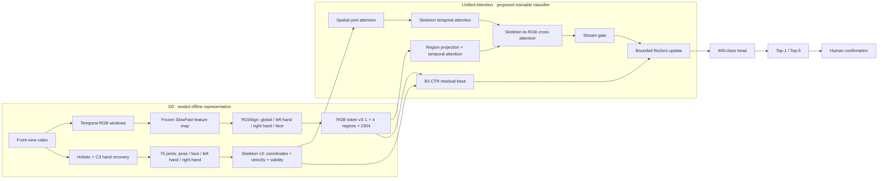

# MS-STA v6 Unified Attention: video-to-Top-k pipeline

> **Live SoT:** Unified Attention = `DEFENSE_GO`. Primary contrast: Unified Attention vs Simple Combined.

**Tên trong mã nguồn:** Unified Attention = `b4_v6_ctr` · Simple Combined Baseline = `b3_mlp_ctr` (B3+MLP) · Ghép đặc trưng CTR = `b3_ctr_concat` · Chỉ RGB = `rgb_strong`.

> Metrics: [`B4_CURRENT_REPORT.md`](B4_CURRENT_REPORT.md). Demo is **cache-backed offline**.
> **Sơ đồ Mermaid chuẩn bảo vệ (đầy đủ Input→từng bước→Output):** [`MSSTA_DEFENSE_FULL_FLOW_MERMAID.md`](MSSTA_DEFENSE_FULL_FLOW_MERMAID.md).

**Unified Attention là mô hình đề xuất khi bảo vệ. Thử nghiệm nén mạng là phụ lục âm, không triển khai.**

## Block diagram (tóm tắt kỹ thuật)

> Bản đầy đủ cho hội đồng (protocol + gate + test + demo + claim limits): xem **Hình M1–M4** trong [`MSSTA_DEFENSE_FULL_FLOW_MERMAID.md`](MSSTA_DEFENSE_FULL_FLOW_MERMAID.md).

## Fair controls

| Variant | Purpose |
|---|---|
| `rgb_strong` | RGB-only baseline |
| `b3_ctr_concat` | Simple RGB–Skeleton fusion control |
| `b3_mlp_ctr` | Strong near-parameter-matched control: shared Skeleton spatial/temporal encoder CTR-matched, no RGB-temporal/cross/gate/residual update |
| **`Unified Attention`** | **Proposed MS-STA model** |
| `e4_w192` | Appendix-only efficiency ablation; `E4_ACCURACY_NO_GO`, never test/demo |

Validation uses three seeds. The test uses the frozen seed-42 checkpoints once as retrospective signer-disjoint confirmation; these numbers are reported in separate tables.

## Demo contract

The browser shows the raw Front RGB clip beside an animation reconstructed from the sealed Skeleton v3 cache. The viewer can switch between raw landmark motion and display-only torso/face stabilization; neither mode changes Unified Attention inference. Unified Attention consumes RGB-token v3 and Skeleton v3 NPZ files and fails closed on missing/tampered inputs. Stream-gate and residual values may be shown as model diagnostics; they are not presented as spatial/temporal attention maps.

## Trace to source

| Component | Source |
|---|---|
| RGB map / ROI tokens | `src/models/rgb_token_v3.py` |
| Skeleton layout and graph | `src/data_prep/joint_layout_v3.py` |
| D0 data contract | `src/training/ms_sta_v5_data.py` |
| Unified Attention architecture | `src/models/ms_sta_v6.py` |
| API identity/cache loading | `src/deployment/backend_api.py` |
| RGB–Skeleton browser view | `src/deployment/app.py`, `skeleton_visualization.py` |
