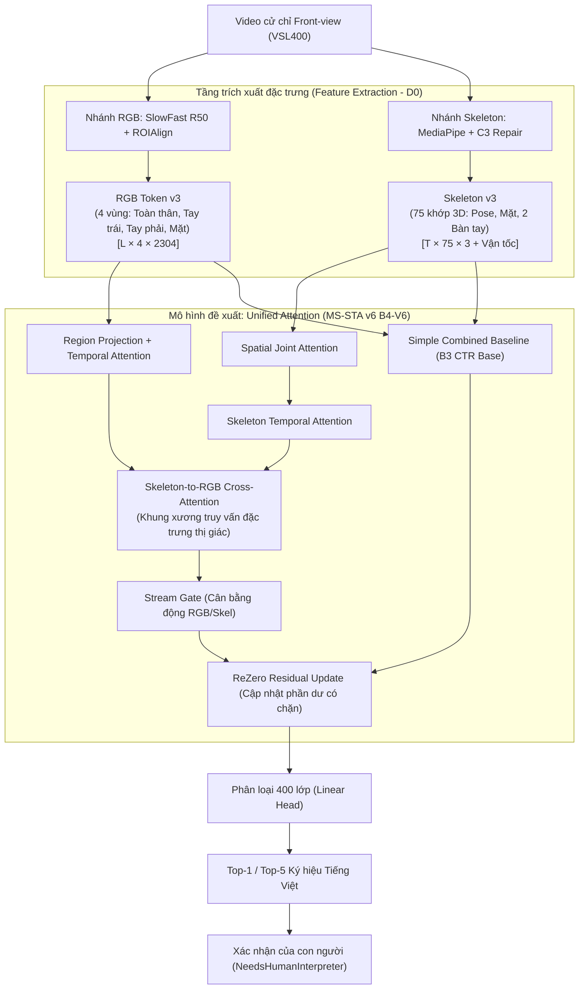

# BÁO CÁO TỔNG QUAN TOÀN DIỆN ĐỒ ÁN TỐT NGHIỆP
## Nhận Dạng Ngôn Ngữ Ký Hiệu Việt Nam Cấp Độ Từ Đơn (VSL400 Word-Level) Bằng Mô Hình Chú Ý Hợp Nhất (Unified Attention)

---

> **Dành cho Giảng viên hướng dẫn & Hội đồng bảo vệ đồ án**  
> **Phiên bản:** Niêm phong bảo vệ chính thức (`DEFENSE_GO`) — Tháng 09/2026  
> **Mã nguồn & Demo:** Đã đóng gói tại `dist/submission/` (`VSL_SOURCE.zip`, `VSL_DEMO.zip`)  
> **Mô hình đề xuất:** **Unified Attention** (Mô hình Chú ý Hợp nhất, định danh kỹ thuật: `b4_v6_ctr`)  
> **Trọng số niêm phong (Seed 42):** SHA-256 `0b73f8f231525f239d330dabb7882556cbd71ce398fa20ded68784f418758be1`

---

## MỤC LỤC

1. [Tổng quan bài toán & Bộ dữ liệu VSL400](#1-tổng-quan-bài-toán--bộ-dữ-liệu-vsl400)
2. [Kiến trúc kỹ thuật & Luồng xử lý đa phương thức (Architecture & Pipeline)](#2-kiến-trúc-kỹ-thuật--luồng-xử-lý-đa-phương-thức)
3. [Kết quả thực nghiệm khoa học & Bằng chứng niêm phong (Empirical Results)](#3-kết-quả-thực-nghiệm-khoa-học--bằng-chứng-niêm-phong)
4. [Tối ưu hóa suy luận & Nghiên cứu phụ lục (Optimized Inference & Appendix)](#4-tối-ưu-hóa-suy-luận--nghiên-cứu-phụ-lục)
5. [Hướng dẫn nộp bài & Chạy Demo trước Hội đồng (Deployment & Demo)](#5-hướng-dẫn-nộp-bài--chạy-demo-trước-hội-đồng)
6. [Bản đồ chỉ mục tài liệu đồ án (Documentation Hub)](#6-bản-đồ-chỉ-mục-tài-liệu-đồ-án)

---

## 1. TỔNG QUAN BÀI TOÁN & BỘ DỮ LIỆU VSL400

### 1.1 Mục tiêu đề tài
Đề tài tập trung giải quyết bài toán **nhận dạng ngôn ngữ ký hiệu Việt Nam cấp độ từ đơn** (*word-level isolated sign recognition*) từ dữ liệu video, nhằm hỗ trợ giao tiếp giữa cộng đồng người Điếc và người nghe nói thông thường.

- **Số lượng từ vựng:** 400 lớp từ đơn tiếng Việt thông dụng (`VSL400`).
- **Tổng số mẫu dữ liệu:** 24.752 video ngắn, quay ở góc nhìn chính diện (*Front-view*).
- **Đầu ra hệ thống:** Dự đoán Top-1 và Top-5 danh sách từ ký hiệu tiếng Việt có độ tin cậy cao nhất, đi kèm cơ chế **xác nhận của con người** (*Human-in-the-loop / NeedsHumanInterpreter*) trước khi đưa vào văn bản đích.

### 1.2 Thách thức & Tiêu chuẩn khoa học cốt lõi
Hầu hết các nghiên cứu trước đây gặp hiện tượng "học vẹt người ra dấu" do chia tập train/test ngẫu nhiên (người xuất hiện ở tập test đã từng xuất hiện ở tập train). Đồ án này áp dụng nguyên tắc khoa học nghiêm ngặt:

1. **Giao thức độc lập người ra dấu (*Signer-Independent / Signer-ID Disjoint*):** Toàn bộ người ra dấu trong tập kiểm thử (Test set) **hoàn toàn không xuất hiện** trong tập huấn luyện (Train set) và tập kiểm định (Validation set). Đây là thử thách thực tế cao nhất, đòi hỏi mô hình phải học đặc trưng cử chỉ học thuật thay vì nhận diện khuôn mặt hoặc vóc dáng người ra dấu.
2. **Ranh giới công bố trung thực:**
   - Hệ thống được thiết kế để nhận dạng **từ đơn lẻ** (*word-level*), phục vụ tra từ điển và kiểm tra cử chỉ; **không tuyên bố dịch câu liên tục** (*continuous sentence translation*).
   - Kết quả thực nghiệm không so sánh trực tiếp với các con số 76–93% trong bài báo gốc VSL400 vì bài báo đó dùng giao thức chia ngẫu nhiên (signer-dependent), trong khi đồ án này đánh giá độc lập người ra dấu khắt khe hơn.

---

## 2. KIẾN TRÚC KỸ THUẬT & LUỒNG XỬ LÝ ĐA PHƯƠNG THỨC

Hệ thống kết hợp sức mạnh của 2 nguồn tín hiệu bổ trợ: **hình ảnh thị giác (RGB)** và **khung xương chuyển động (Skeleton)**.



### 2.1 Tiền xử lý & Trích xuất đặc trưng (D0 Pipeline)
- **Nhánh RGB:** Sử dụng backbone SlowFast 8x8 ResNet-50 (đóng băng trọng số), áp dụng `ROIAlign` để tách và gom 4 vùng tác động chính: *Toàn cảnh (Global)*, *Tay trái (Left hand)*, *Tay phải (Right hand)*, và *Mặt (Face)* $\to$ Tạo tensor đặc trưng `RGB-token v3` kích thước $L \times 4 \times 2304$.
- **Nhánh Skeleton:** Trích xuất qua MediaPipe Holistic tích hợp thuật toán sửa lỗi khớp bàn tay C3 $\to$ Tạo ma trận 75 điểm khớp 3D (bao gồm tọa độ, vận tốc biến thiên và cờ độ tin cậy) $\to$ `Skeleton v3`.

### 2.2 Cơ chế hoạt động của Unified Attention
1. **Spatial & Temporal Attention:** Nhánh skeleton tự học tương quan giữa các ngón tay và khớp cổ tay qua từng khung hình; nhánh RGB học trọng số chuyển động theo thời gian của từng vùng ROI.
2. **Cross-Attention Đa phương thức:** Nhánh khung xương đóng vai trò truy vấn (*Query*), định hướng chú ý vào các vùng đặc trưng thị giác tương ứng (*Key/Value*) của nhánh RGB.
3. **Stream Gate:** Tính toán tỷ trọng đóng góp linh hoạt giữa tín hiệu hình ảnh và chuyển động khớp theo từng loại ký hiệu.
4. **Bounded ReZero Residual:** Khởi tạo từ nền tảng vững chắc của mốc mờ đối chứng (Simple Combined Baseline B3 CTR) và cộng thêm phần gia số học được từ cơ chế Attention với hệ số $\alpha$ có chặn, đảm bảo mô hình không bị suy thoái và hội tụ ổn định.

---

## 3. KẾT QUẢ THỰC NGHIỆM KHOA HỌC & BẰNG CHỨNG NIÊM PHONG

Tất cả các số liệu dưới đây được đo đạc trên cùng một giao thức phân chia signer-disjoint, cùng tập đặc trưng đầu vào và cùng cấu hình encoder.

### 3.1 Bảng so sánh kết quả chính thức (Source of Truth)

| Tập dữ liệu đánh giá | Simple Combined Baseline | Unified Attention (Đề xuất) | Chênh lệch ($\Delta$ Top-1) | Ý nghĩa thống kê & Kiểm định |
|---|---:|---:|---:|---|
| **Validation** (Trung bình 3 seeds: 42, 123, 456) | 80,54 ± 1,57% | **84,81 ± 0,51%** | **+4,27 điểm %** | CI95: $[+2,94; +5,69]$ (Thắng cả 3 seeds) |
| **Test** (Signer-ID Disjoint, $n=6.165$ mẫu) | 42,22% | **51,55%** | **+9,33 điểm %** | CI95: $[+6,37; +11,34]$, McNemar $p \approx 2,8 \times 10^{-50}$ |

> **Nhận xét khoa học:**  
> - Trên tập kiểm định (Validation), mô hình đề xuất cải thiện **+4,27 điểm phần trăm**, độ lệch chuẩn giảm mạnh ($0,51\%$ so với $1,57\%$), chứng minh tính ổn định cao.  
> - Trên tập kiểm thử độc lập người ra dấu (Test hồi cứu), mô hình đạt bước nhảy vọt **+9,33 điểm phần trăm** (từ $42,22\%$ lên $51,55\%$), với giá trị $p$ của kiểm định McNemar cực nhỏ ($1047$ mẫu chuyển từ sai sang đúng so với $472$ mẫu ngược lại), khẳng định cơ chế chú ý hợp nhất giải quyết vượt trội vấn đề người ra dấu mới lạ.

### 3.2 Bằng chứng niêm phong kỹ thuật
- **Checkpoint bảo vệ chính thức:** `Docs/results/ms_sta_v6_defense/checkpoints/b4_v6_ctr_seed42/best.pt`
- **Mã băm SHA-256:** `0b73f8f231525f239d330dabb7882556cbd71ce398fa20ded68784f418758be1`
- **Cổng nghiệm thu D4:** Đạt tuyệt đối **15/15** bài kiểm tra tính toàn vẹn checkpoint, cache, fail-closed khi thiếu dữ liệu và forward pass.

---

## 4. TỐI ƯU HÓA SUY LUẬN & NGHIÊN CỨU PHỤ LỤC

### 4.1 Đóng góp hệ thống: Optimized Inference (Protocol B)
Để phục vụ triển khai trong điều kiện tài nguyên phần cứng giới hạn, đồ án thực hiện tối ưu hóa hệ thống trên **cùng một checkpoint mô hình B4-V6** (không huấn luyện lại):
- Kỹ thuật: Gom mẻ trích xuất ROI và tính toán nửa độ chính xác (AMP - Automatic Mixed Precision).
- Kết quả: Đạt gia tốc suy luận $\approx \mathbf{1,220\times}$ so với quy trình gốc.
- Tính bảo toàn: Độ chính xác giữ nguyên tương đương (49,943% vs 49,895%, khoảng tin cậy CI95 $[-0,015; +0,147]$ chứa 0, chứng minh gia tốc không làm tổn hại chất lượng nhận dạng).

### 4.2 Phụ lục nghiên cứu âm: Nén & Thu nhỏ mạng nơ-ron sâu (E4 Series - NO-GO)
- Trong quá trình nghiên cứu, nhóm đã thử nghiệm thu hẹp độ rộng kênh và chưng cất tri thức (Knowledge Distillation) để giảm kích thước mạng (`E4_SYSKD`).
- **Kết quả:** Tất cả các biến thể thu nhỏ đều làm sụt giảm độ chính xác Top-1 từ $-1,90$ đến $-3,69$ điểm phần trăm (CI95 hoàn toàn nằm dưới 0).
- **Quyết định khoa học:** Theo hợp đồng kiểm soát chất lượng, cổng kiểm định độ chính xác bị từ chối (`E4_ACCURACY_NO_GO`). Nhóm **dứt khoát không triển khai** mô hình nén này làm mô hình bảo vệ, mà đưa vào báo cáo dưới dạng **phụ lục nghiên cứu âm** để làm rõ bài học kinh nghiệm về sự đánh đổi giữa kích thước tham số và khả năng biểu diễn cử chỉ phức tạp.

---

## 5. HƯỚNG DẪN NỘP BÀI & CHẠY DEMO TRƯỚC HỘI ĐỒNG

### 5.1 Cấu trúc hai gói bàn giao độc lập (`dist/submission/`)
1. **`VSL_SOURCE.zip` (269 MB):** Chứa toàn bộ mã nguồn `src/`, kịch bản nghiên cứu `scripts/`, bộ test `tests/`, tài liệu báo cáo `Docs/` và cấu hình CI. Tuyệt đối không chứa môi trường ảo, dữ liệu thô cồng kềnh hay API token riêng tư.
2. **`VSL_DEMO.zip` (295 MB):** Chứa toàn bộ mã chạy ứng dụng, checkpoint B4-V6, backbone SlowFast, 8 video clip mẫu (2 clip demo chính và 6 clip validation) cùng feature cache đã khóa SHA. Hoạt động **100% offline**, không cần kết nối mạng hay tải thêm trọng số.

### 5.2 Các bước chạy Demo trên máy Windows (từ gói `VSL_DEMO.zip`)
Yêu cầu: Máy tính cài sẵn Python 3.11 và FFmpeg trên PATH.

```powershell
# Bước 1: Giải nén gói VSL_DEMO.zip sang một thư mục sạch
Expand-Archive -Path dist\submission\VSL_DEMO.zip -DestinationPath C:\Demo_VSL

# Bước 2: Tạo môi trường ảo và cài đặt thư viện
cd C:\Demo_VSL
py -3.11 -m venv env_demo
.\env_demo\Scripts\python.exe -m pip install -r requirements-demo-lock.txt
.\env_demo\Scripts\python.exe -m pip check

# Bước 3: Chạy script kiểm tra tự động trước khi demo (smoke + UI test)
.\env_demo\Scripts\python.exe scripts/verify_submission.py --smoke --ui

# Bước 4: Khởi chạy ứng dụng demo bảo vệ
powershell.exe -NoProfile -ExecutionPolicy Bypass -File .\scripts\demo_vsl400.ps1
```

Trình duyệt sẽ tự động mở giao diện tại `http://localhost:8501`:
1. Tại màn hình chính, chọn một trong hai kịch bản mẫu có sẵn: `023292` (Cái đèn) hoặc `018613` (Cô).
2. Nhấn nút **Run recognition**.
3. Quan sát kết quả dự đoán Top-5 danh sách từ ký hiệu và bảng chẩn đoán tỷ trọng Attention giữa hình ảnh và khung xương.
4. Nhấn nút **Confirm** để hoàn tất quy trình tương tác người - máy.

---

## 6. BẢN ĐỒ CHỈ MỤC TÀI LIỆU ĐỒ ÁN (DOCUMENTATION HUB)

Để giúp Giảng viên và Hội đồng tra cứu thuận tiện nhất, toàn bộ tài liệu trong thư mục `Docs/` được phân bổ như sau:

| Nhóm tài liệu | Đường dẫn tệp | Mục đích sử dụng |
|---|---|---|
| **Tổng quan & Bàn giao** | [`Docs/TONG_QUAN_DO_AN.md`](TONG_QUAN_DO_AN.md) | **Tài liệu nòng cốt số 1**: Đọc toàn bộ đề tài từ A-Z |
| | [`Docs/SUBMISSION.md`](SUBMISSION.md) | Hướng dẫn chi tiết đóng gói, kiểm tra mã băm và cài đặt demo |
| **Báo cáo nộp Khoa** | `Docs/thesis/VSL_MSSTA_REPORT.tex` | Toàn văn đồ án tốt nghiệp định dạng LaTeX |
| | `Docs/thesis/*.pdf`, `Docs/thesis/*.docx` | Bản in và bản nộp chính thức đồ án tốt nghiệp |
| **Slide và tài liệu bảo vệ** | `Docs/thesis/25410035_PhamMinhDuc_25410012_NguyenThiKieuThanh_DATN.pptx` | Bộ slide dùng khi bảo vệ ngày 10/10/2026 |
| | `Docs/thesis/bao-ve-2026-10-10/` | Kịch bản thuyết trình, bộ hỏi đáp và biên bản rà soát trước buổi bảo vệ |
| **Tái lập & Bằng chứng** | [`Docs/REPRODUCIBILITY.md`](REPRODUCIBILITY.md) | Hướng dẫn tái lập kỹ thuật từ checkpoint và script |
| | `Docs/results/ms_sta_v6_defense_go/` | Toàn bộ chứng cứ số liệu, báo cáo JSON niêm phong |
| **Hành trình nghiên cứu** | [`Docs/NHAT_KY_DO_AN.md`](NHAT_KY_DO_AN.md) | Nhật ký ghi lại toàn bộ quá trình nghiên cứu, thử nghiệm |
| | [`Docs/B4_CURRENT_REPORT.md`](B4_CURRENT_REPORT.md) | Bảng tra cứu số liệu đối chứng tóm tắt |

---
*Tài liệu này được biên soạn và kiểm chứng tự động phục vụ kỳ bảo vệ Đồ án Tốt nghiệp.*
